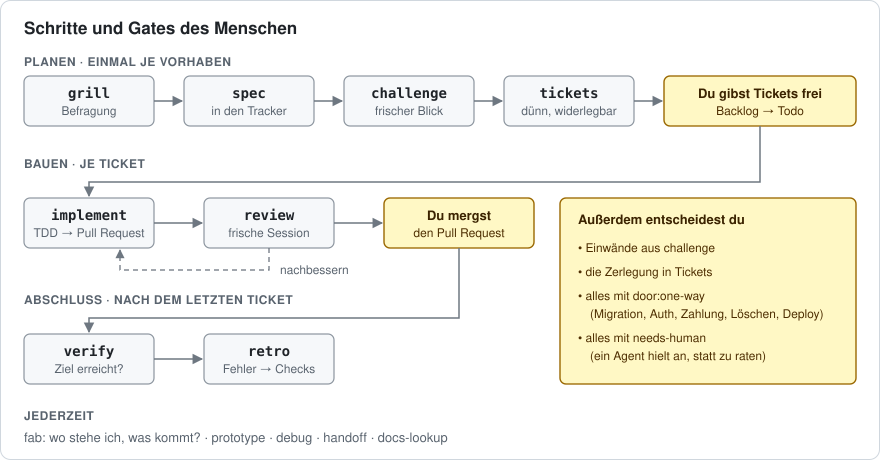
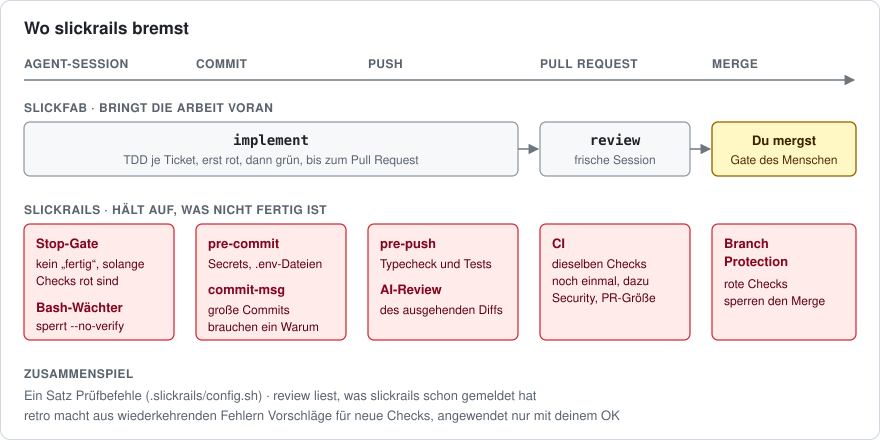
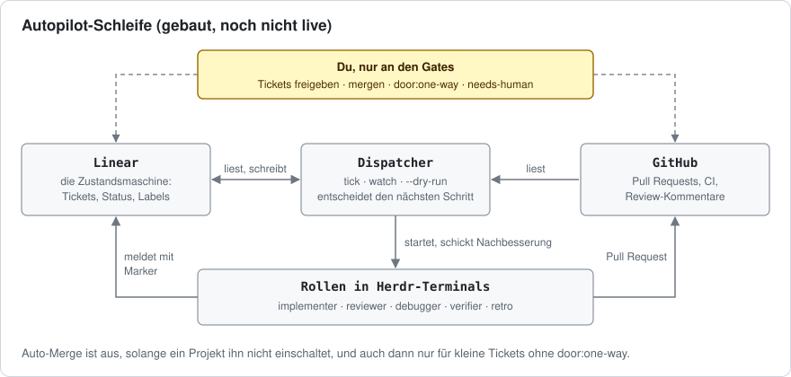

# slickfab

> English: [README.md](README.md)

**Ein Prozess für AI-gebaute Software, von der Idee bis zum gemergten Pull Request.** slickfab ist ein Claude-Code-Plugin für einen Entwickler mit Coding-Agents. Es zerlegt die Arbeit in feste Schritte, lässt prüfende Schritte von frischen Agents machen und holt dich nur dort dazu, wo die Entscheidung bei dir liegt.

Die Schritte, Rollen und die Doku unter `docs/` sind derzeit auf Deutsch.

## Das Problem

Wer mit Claude Code baut, kennt den Ablauf: Die Idee wird im Chat besprochen, der Agent baut los, meldet „fertig“, und du schaust nach, ob das stimmt. Dabei gehen drei Dinge schief.

- **Die Spec bleibt ungeprüft im Chat.** Was gebaut werden soll, steht verstreut in einem Gespräch. Niemand hat es gegengelesen, offene Entscheidungen fallen erst beim Bauen auf, und dann entscheidet der Agent sie still.
- **Jede Übergabe läuft über dich.** Von der Spec zu Tickets, vom Ticket zum Agent, vom Pull Request zum Review: Du kopierst Kontext von einer Session in die nächste. Der Prüfer kennt dabei oft den Bericht des Bauers und prüft dessen Sicht statt des Codes.
- **„Fertig“ hat keinen Beleg.** Der Agent sagt, die Tests sind grün. Ob ein Test erst rot war, ob er überhaupt das Kriterium prüft und ob das Ziel der Spec über alle Tickets erreicht ist, sagt dir niemand.

## Was slickfab tut

slickfab macht aus diesem Ablauf einen festen Prozess mit **13 Schritten** (Tabelle unten). Jeder Schritt ist eine Anleitung (`skills/<schritt>/SKILL.md`) mit Eingang, Ablauf, Stopp-Regeln und einem festen Ergebnis, das den nächsten Schritt nennt.

<p align="center">
  
</p>

- **Specs werden geklärt und geprüft, bevor gebaut wird.** `grill` fragt dich in Runden aus, bis keine Entscheidung mehr offen ist. `spec` schreibt das Ergebnis in den Tracker (Linear), `challenge` prüft es mit frischem Blick, `tickets` schneidet es in dünne Tickets mit widerlegbaren Kriterien.
- **Übergaben laufen über den Tracker, nicht über dich.** Linear ist die einzige Wahrheit über Plan und Zustand. Jeder Schritt liest dort, was er braucht, und schreibt sein Ergebnis zurück. Im Repo gibt es keine Plan- oder Zustandsdatei.
- **„Fertig“ braucht Belege.** `implement` baut ein Ticket per TDD und belegt im Pull Request für jedes Kriterium den roten und den grünen Lauf. `review` prüft in einer frischen Session, getrennt vom Umsetzer, auch mit einer Mutationsprobe. `verify` prüft nach dem letzten Merge, ob das Ziel der Spec wirklich erreicht ist.
- **Sieben Rollen** führen die Schritte als frische Subagents aus: `slickfab:planner`, `slickfab:challenger`, `slickfab:implementer`, `slickfab:reviewer`, `slickfab:debugger`, `slickfab:verifier` und `slickfab:retro`. Eine Rolle kann dich nicht fragen. Wo sie eine Entscheidung bräuchte, hört sie auf und meldet `NEEDS_CONTEXT` oder `BLOCKED`, statt zu raten. Dazu kommt der Doku-Leser `slickfab:docs-reader` für `docs-lookup`.
- **Drei Betriebsarten** mit denselben Schritten: Hand, Assistiert, Autopilot (siehe unten).
- **Der Mensch entscheidet an Gates:** Ticket freigeben (`Backlog` → `Todo`), Einwände aus `challenge`, die Zerlegung, der Merge, alles mit `door:one-way` (Migration, Auth, Zahlung, Löschen, Deploy) und alles mit `slickfab:needs-human`. Dazwischen arbeiten die Schritte ohne dich.

## slickfab und slickrails

[slickrails](https://github.com/l0kl97/slickrails) sind die Bremsen, slickfab ist das Gaspedal.

- **slickrails** zieht einen Engineering-Standard ins Repo und setzt ihn mechanisch durch: Git-Hooks (Secrets-Scan, Tests und Typecheck vor dem Push), ein lokales AI-Review vor jedem Push, ein Stop-Gate, das eine Agent-Session nicht enden lässt, solange die Checks rot sind, einen Bash-Wächter gegen `--no-verify` und Ähnliches, dazu CI und Branch Protection. slickrails sagt, *was nicht durchkommt*.
- **slickfab** gibt die Richtung vor: welcher Schritt als Nächstes kommt, welche Rolle ihn macht, wer an welchem Gate entscheidet, und im Autopilot, welche Rollen parallel laufen. slickfab sagt, *wie die Arbeit vorankommt*.

<p align="center">
  
</p>

Beide funktionieren allein. Zusammen greifen sie so ineinander:

- **Ein Satz Prüfbefehle.** Liegt im Repo `.slickrails/config.sh`, nimmt slickfab die Prüfbefehle (`CHECK_TEST`, `CHECK_TYPECHECK`, `CHECK_LINT`) von dort, genau die, die auch die slickrails-Hooks benutzen. `CHECK_*`-Werte in `.slickfab/config` gelten dann nicht.
- **`implement` läuft mit den Hooks, nicht um sie herum.** Der Umsetzer umgeht keinen Hook. Ein rotes Stop-Gate oder ein Befund des AI-Reviews beim Push heißt: nicht fertig, Befund beheben.
- **`review` prüft nicht doppelt.** Der Reviewer liest zuerst, was slickrails schon gemeldet hat (Status-Checks, Kommentare des AI-Reviews), meldet das nicht ein zweites Mal und wertet Rot dort wie Rot bei sich. Er liest außerdem `.slickrails/rules.md` und `.slickrails/review-learnings.md`.
- **`retro` schlägt neue Bremsen vor.** Aus wiederkehrenden mechanischen Fehlern werden Vorschläge für slickrails-Checks, aus Ermessensfällen Einträge für `.slickrails/review-learnings.md`. Angewendet wird nichts ohne dich.

**Empfehlung: erst slickrails, dann slickfab.** Ohne slickrails funktioniert jeder Schritt, aber die Bremsen fehlen; dann gelten nur die Prüfbefehle aus `.slickfab/config`, und ob sie laufen, hängt am Agent.

```sh
# 1. slickrails ins Projekt (Installation: https://github.com/l0kl97/slickrails#quickstart)
cd dein-projekt
slickrails init

# 2. slickfab als Plugin (siehe „Installieren“), dann in Claude Code:
/slickfab:fab
```

## Installieren

slickfab ist ein Claude-Code-Plugin. Das Repo ist zugleich sein eigener Marketplace:

```sh
claude plugin marketplace add l0kl97/slickfab
claude plugin install slickfab@slickfab
```

Zum Ausprobieren ohne Installation: `claude --plugin-dir <pfad-zu-slickfab>`.

Das Projekt, in dem du arbeitest, darf nicht im Plugin-Ordner liegen. Claude Code schützt Dateien dort als „sensitive file“, und dann darf kein Schritt schreiben. Wer an slickfab selbst arbeitet, tut das deshalb in einem Worktree außerhalb des Plugin-Ordners (`git worktree add` oder `runtime/herdr/slickfab-worktree add`).

Ab `spec` brauchen die Schritte im Projekt eine `.slickfab/config` mit Tracker, Team und Projekt (`docs/projektkonfiguration.md`), angemeldete Linear-Werkzeuge in Claude Code und für Pull Requests ein angemeldetes `gh`. Die Regeln für Linear stehen in `tracker/linear.md`.

## Schnellstart

```
/slickfab:fab                       # wo stehe ich, was fehlt, was kommt als Nächstes?
/slickfab:grill <dein Vorhaben>     # erster Schritt in einem Repo ohne Vorarbeit
```

`fab` ist der Wegweiser. Es sagt dir, was zur Einrichtung fehlt (und schlägt eine `.slickfab/config` vor), wo ein Vorhaben steht und welcher Schritt als Nächstes kommt. `grill` braucht noch keinen Tracker.

Der übliche Weg: `grill` → `spec` → `challenge` → `tickets` → du setzt Tickets auf `Todo` → je Ticket `implement` → `review` → du mergst → nach dem letzten Ticket `verify` → `retro`.

## Schritte

| Schritt | Zweck |
|---|---|
| `fab` | Wegweiser: wo stehe ich, was kommt als Nächstes |
| `grill` | Befragung in Runden, bis keine Entscheidung mehr offen ist |
| `spec` | Spezifikation aus dem Gespräch |
| `prototype` | Fragen klären, die man nicht erfragen kann |
| `challenge` | Produkt-, Baubarkeits- und Zerlegungsprüfung durch einen frischen Blick |
| `tickets` | Dünne, vertikale Tickets mit widerlegbaren Kriterien |
| `implement` | Ein Ticket per TDD bis zum PR |
| `review` | Frischer Review auf zwei Achsen |
| `debug` | Fehler mit roter Schleife und Hypothesen finden |
| `verify` | Ist das Ziel der Spec über alle Tickets erreicht? |
| `retro` | Aus Fehlern werden Checks |
| `handoff` | Übergabe bei Kontextwechsel |
| `docs-lookup` | Aktuelle Library-Doku, versionsgenau, ohne den Kontext zu füllen |

Welcher Schritt in welcher Session läuft (gleiches Gespräch oder frisch): `docs/betriebsarten.md`, Abschnitt „The steps“ (englisch).

## Betriebsarten

Es sind immer dieselben 13 Schritte; die Betriebsart legt nur fest, wer sie startet. Ausführlich mit Einrichtung: `docs/betriebsarten.md`.

Nur der Autopilot braucht [Herdr](https://herdr.dev/); Hand und Assistiert laufen ohne.

- **Hand:** Du rufst `/slickfab:<schritt>` selbst auf, in deiner Session. Geht in jedem Claude Code, ohne weitere Werkzeuge.
- **Assistiert:** Eine Session, die Schritte laufen als frische Subagents in den sieben Rollen. Du gibst jeder Rolle nur ihren Eingang (Ticket, PR, Spec-Issue) und entscheidest in der Haupt-Session, wenn sie `NEEDS_CONTEXT` oder `BLOCKED` meldet. Wächter-Hooks begrenzen die Bash-Befehle der prüfenden Rollen und des Doku-Lesers; context-guard warnt Rollen in Herdr-Terminals, wenn der Kontext voll wird.
- **Autopilot:** noch nicht live, aber gebaut. Ein Dispatcher (`runtime/herdr/slickfab-dispatch`, `tick`, `watch`, `--dry-run`) startet die Rollen parallel in Herdr-Terminals, Linear ist die Zustandsmaschine, du greifst nur an den Gates ein. Er ist gegen nachgestellte Dienste getestet und lief als Dry-Run gegen ein echtes Linear; im Produktiveinsatz ist er noch nicht.

<p align="center">
  
</p>

## Stand und Grenzen

- **Hand und Assistiert sind in Gebrauch.** Alle 13 Schritte und die sieben Rollen sind gebaut; slickfab wird mit sich selbst weiterentwickelt.
- **Autopilot:** gebaut und im Dry-Run getestet, noch nicht im Produktiveinsatz. Ob er im echten Betrieb trägt, zeigt erst ein Pilot. Die Factory-Konfiguration je Projekt (`auto_merge`, `github_ci` und andere) liegt außerhalb des Repos; die Felder beschreibt `docs/features/slickfab-dispatch.md`.
- **Wie belastbar die Rollen sind:** Jede Rolle hat Pressure-Szenarien, Lagen, die zu einer Abkürzung drängen (Gate rot und Zeitdruck, Test im Weg, „egal, mach du“). Die Rollen hielten in 14 von 14 Szenarien, die Kontrolle mit älteren Vorlagen bzw. ohne Anleitung in 2 von 14. Bewertet ist von Hand, nicht maschinell; Szenarien, Läufe und Grenzen in `docs/features/pressure-szenarien.md`.
- **Nur Linear.** Den Tracker-Vertrag gibt es heute nur für Linear (`tracker/linear.md`).
- **Nur Claude Code.** Die Schritte sind Claude-Code-Skills, die Rollen Claude-Code-Agents.
- **Auf Deutsch.** Schritte, Rollen und Doku sind derzeit deutsch geschrieben.

## Herkunft

slickfab übernimmt Ideen aus mattpocock/skills, obra/superpowers, open-gsd/gsd-core, addyosmani/agent-skills und upstash/context7 (alle MIT), in eigenen Worten umgesetzt; wörtliche Übernahmen gibt es bisher keine. Lizenzhinweise in `NOTICE`, die Auswertung der Vorbilder in `docs/research/`.

## Lizenz

[MIT](LICENSE)
