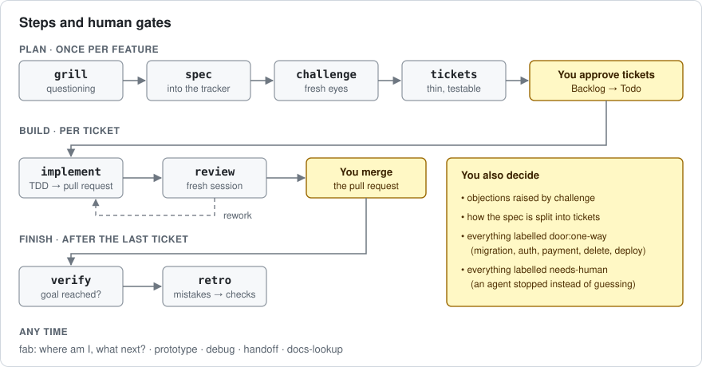
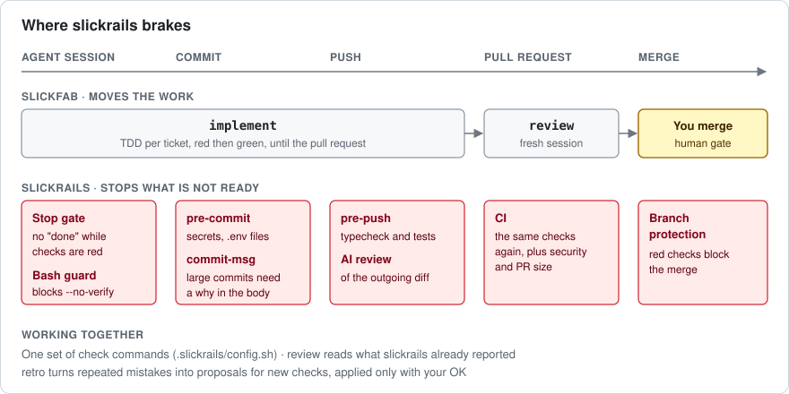
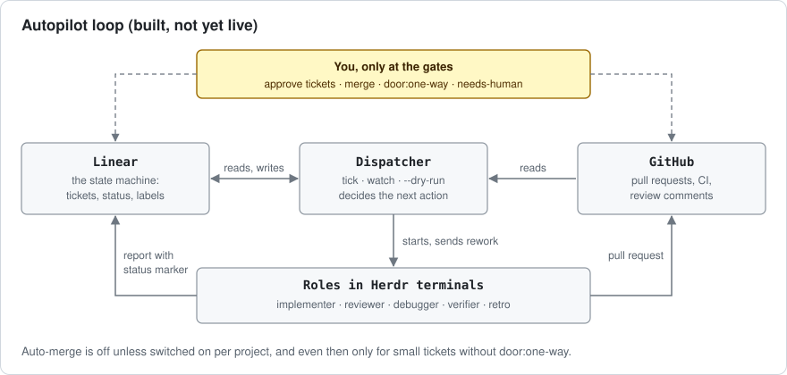

# slickfab

> Deutsch: [README.de.md](README.de.md)

**A process for AI-built software, from the idea to the merged pull request.** slickfab is a Claude Code plugin for one developer working with coding agents. It splits the work into fixed steps, has the checking steps done by fresh agents, and brings you in only where the decision is yours.

The steps, roles and the docs under `docs/` are currently written in German.

## The problem

If you build with Claude Code, you know the routine: the idea is discussed in chat, the agent starts building, reports "done", and you go and check whether that is true. Three things go wrong along the way.

- **The spec stays unchecked in the chat.** What should be built is scattered across a conversation. Nobody has read it back, open decisions only surface during the build, and then the agent makes them quietly.
- **Every handover runs through you.** From spec to tickets, from ticket to agent, from pull request to review: you copy context from one session into the next. The reviewer often knows the builder's report and checks that view instead of the code.
- **"Done" comes without proof.** The agent says the tests are green. Whether a test was red first, whether it checks the criterion at all, and whether the goal of the spec is reached across all tickets, nobody tells you.

## What slickfab does

slickfab turns this routine into a fixed process with **13 steps** (table below). Each step is an instruction (`skills/<step>/SKILL.md`) with an input, a procedure, stop rules and a fixed result that names the next step.

<p align="center">
  
</p>

- **Specs are clarified and checked before anything is built.** `grill` questions you in rounds until no decision is left open. `spec` writes the result to the tracker (Linear), `challenge` checks it with fresh eyes, `tickets` cuts it into thin tickets with falsifiable criteria.
- **Handovers run through the tracker, not through you.** Linear is the single source of truth for plan and state. Each step reads what it needs there and writes its result back. There is no plan or state file in the repo.
- **"Done" needs proof.** `implement` builds a ticket with TDD and shows the red and the green run for every criterion in the pull request. `review` checks in a fresh session, separate from the implementer, including a mutation probe. `verify` checks after the last merge whether the goal of the spec is really reached.
- **Seven roles** run the steps as fresh subagents: `slickfab:planner`, `slickfab:challenger`, `slickfab:implementer`, `slickfab:reviewer`, `slickfab:debugger`, `slickfab:verifier` and `slickfab:retro`. A role cannot ask you anything. Where it would need a decision, it stops and reports `NEEDS_CONTEXT` or `BLOCKED` instead of guessing. `docs-lookup` has its own docs reader, `slickfab:docs-reader`.
- **Three operating modes** with the same steps: manual, assisted, autopilot (see below).
- **You decide at gates:** approving a ticket (`Backlog` → `Todo`), objections from `challenge`, the ticket split, the merge, everything labelled `door:one-way` (migration, auth, payment, deletion, deploy) and everything labelled `slickfab:needs-human`. In between, the steps work without you.

## slickfab and slickrails

[slickrails](https://github.com/l0kl97/slickrails) is the brakes, slickfab is the gas pedal.

- **slickrails** pulls an engineering standard into the repo and enforces it mechanically: git hooks (secrets scan, tests and typecheck before the push), a local AI review before every push, a Stop gate that does not let an agent session end while checks are red, a Bash guard against `--no-verify` and the like, plus CI and branch protection. slickrails says *what does not get through*.
- **slickfab** sets the direction: which step comes next, which role does it, who decides at which gate, and in autopilot, which roles run in parallel. slickfab says *how the work moves forward*.

<p align="center">
  
</p>

Each works on its own. Together they mesh like this:

- **One set of check commands.** If the repo has `.slickrails/config.sh`, slickfab takes the check commands (`CHECK_TEST`, `CHECK_TYPECHECK`, `CHECK_LINT`) from there, the same ones the slickrails hooks use. `CHECK_*` values in `.slickfab/config` then do not apply.
- **`implement` runs with the hooks, not around them.** The implementer never bypasses a hook. A red Stop gate or a finding from the AI review on push means: not done, fix the finding.
- **`review` does not check twice.** The reviewer first reads what slickrails has already reported (status checks, comments of the AI review), does not report it a second time, and treats red there like red in its own findings. It also reads `.slickrails/rules.md` and `.slickrails/review-learnings.md`.
- **`retro` proposes new brakes.** Recurring mechanical mistakes become proposals for slickrails checks, judgment calls become entries for `.slickrails/review-learnings.md`. Nothing is applied without you.

**Recommendation: slickrails first, then slickfab.** Every step works without slickrails, but the brakes are missing; then only the check commands from `.slickfab/config` apply, and whether they run depends on the agent.

```sh
# 1. slickrails into the project (install: https://github.com/l0kl97/slickrails#quickstart)
cd your-project
slickrails init

# 2. slickfab as a plugin (see "Install"), then in Claude Code:
/slickfab:fab
```

## Install

slickfab is a Claude Code plugin. The repo is its own marketplace:

```sh
claude plugin marketplace add l0kl97/slickfab
claude plugin install slickfab@slickfab
```

To try it without installing: `claude --plugin-dir <path-to-slickfab>`.

The project you work in must not live inside the plugin folder. Claude Code protects files there as "sensitive files", and then no step may write. If you work on slickfab itself, do it in a worktree outside the plugin folder (`git worktree add` or `runtime/herdr/slickfab-worktree add`).

From `spec` on, the steps need a `.slickfab/config` in the project with tracker, team and project (`docs/projektkonfiguration.md`), signed-in Linear tools in Claude Code and, for pull requests, a signed-in `gh`. The rules for Linear are in `tracker/linear.md`.

## Quickstart

```
/slickfab:fab                       # where am I, what is missing, what comes next?
/slickfab:grill <your plan>         # first step in a repo without prior work
```

`fab` is the signpost. It tells you what is missing for the setup (and proposes a `.slickfab/config`), where a piece of work stands and which step comes next. `grill` does not need a tracker yet.

The usual path: `grill` → `spec` → `challenge` → `tickets` → you set tickets to `Todo` → per ticket `implement` → `review` → you merge → after the last ticket `verify` → `retro`.

## Steps

| Step | Purpose |
|---|---|
| `fab` | Signpost: where am I, what comes next |
| `grill` | Questioning in rounds until no decision is left open |
| `spec` | Specification from the conversation |
| `prototype` | Settle questions you cannot settle by asking |
| `challenge` | Product, buildability and ticket-split check with fresh eyes |
| `tickets` | Thin, vertical tickets with falsifiable criteria |
| `implement` | One ticket with TDD up to the PR |
| `review` | Fresh review on two axes |
| `debug` | Find bugs with a red loop and hypotheses |
| `verify` | Is the goal of the spec reached across all tickets? |
| `retro` | Mistakes become checks |
| `handoff` | Handover when the context changes |
| `docs-lookup` | Current library docs for the exact version, without filling the context |

Which step runs in which session (same conversation or fresh): `docs/betriebsarten.md`, section "The steps".

## Operating modes

It is always the same 13 steps; the mode only decides who starts them. In detail, with setup: `docs/betriebsarten.md`.

Only the autopilot needs [Herdr](https://herdr.dev/); manual and assisted mode run without it.

- **Manual:** You call `/slickfab:<step>` yourself, in your session. Works in any Claude Code, without further tools.
- **Assisted:** One session, the steps run as fresh subagents in the seven roles. You give each role only its input (ticket, PR, spec issue) and decide in the main session when it reports `NEEDS_CONTEXT` or `BLOCKED`. Guard hooks limit the Bash commands of the checking roles and the docs reader; context-guard warns roles in Herdr terminals when the context fills up.
- **Autopilot:** not yet live, but built. A dispatcher (`runtime/herdr/slickfab-dispatch`, `tick`, `watch`, `--dry-run`) starts the roles in parallel in Herdr terminals, Linear is the state machine, you step in only at the gates. It is tested against simulated services and ran as a dry run against a real Linear; it is not in production use yet.

<p align="center">
  
</p>

## Status and limits

- **Manual and assisted are in use.** All 13 steps and the seven roles are built; slickfab is developed with itself.
- **Autopilot:** built and dry-run tested, not yet in production use. Only a pilot will show whether it holds up in real operation. The per-project factory configuration (`auto_merge`, `github_ci` and others) lives outside the repo; `docs/features/slickfab-dispatch.md` describes the fields.
- **How robust the roles are:** Each role has pressure scenarios, situations that push towards a shortcut (red gate and time pressure, a test in the way, "whatever, you do it"). The roles held in 14 of 14 scenarios, the control with older templates or no instructions in 2 of 14. Graded by hand, not by machine; scenarios, runs and limits in `docs/features/pressure-szenarien.md`.
- **Linear only.** The tracker contract exists only for Linear today (`tracker/linear.md`).
- **Claude Code only.** The steps are Claude Code skills, the roles Claude Code agents.
- **In German.** Steps, roles and docs are currently written in German.

## Origins

slickfab takes ideas from mattpocock/skills, obra/superpowers, open-gsd/gsd-core, addyosmani/agent-skills and upstash/context7 (all MIT), implemented in its own words; there are no verbatim copies so far. License notices in `NOTICE`, the evaluation of the sources in `docs/research/`.

## License

[MIT](LICENSE)
